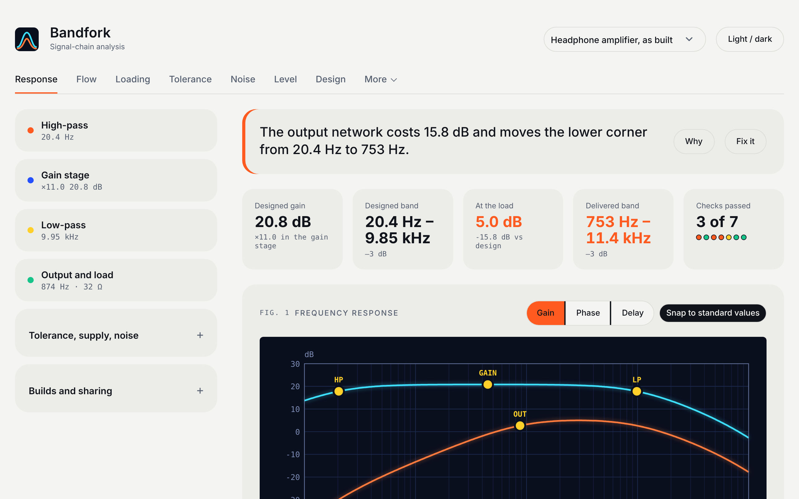

# Bandfork

**Confirm on the bench.**

Companion to my band-pass headphone amplifier (20.4 Hz to about 10 kHz, 20.8 dB).

The filter alone looked fine. With the output network and a 32 Ω load, the modelled lower corner moved to 753 Hz and the signal at 1 kHz lost 17.6 dB. Bandfork models the whole chain, source to load, so you see that before you build.

## What it does

- Frequency response of every stage, with the load included
- Component tolerance, clipping, noise and current through each stage
- Animated signal flow through the circuit
- Pass or fail checks, and a SPICE netlist export
- Compare the model with your bench measurements
- Presets for audio, microphone, ECG and piezo signals

## Use it

Live: https://martinsmagomedovsqed-design.github.io/bandfork/

Install it from the site to run it as an app (Windows, Mac, Android, iPhone). Works offline after the first load.

Built with plain HTML, CSS and JavaScript. No dependencies.
